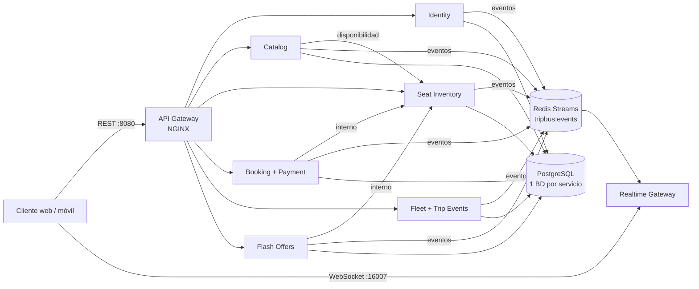

# TripBus · API Gateway y despliegue de la plataforma

Punto de entrada único REST de TripBus (NGINX) **y** repositorio de orquestación: desde aquí se
levanta la plataforma completa del MVP (8 microservicios + PostgreSQL + Redis) con un solo comando.



## Levantar todo en local (Docker Desktop)

Requisitos: Docker Desktop con **6 GB de RAM** asignados y los 8 repositorios clonados en la misma carpeta:

```
Arquitecturas de software/
  API-gateway/  identity/  catalog-service/  seat-inventory-service/  booking-payment-service/
  fleet-trip-events-service/  flash-offerts-service/  Realtime-Gateway/
```

```bash
cd API-gateway
docker compose up -d --build        # la primera vez tarda (descarga dependencias y compila)
docker compose ps                   # esperar a que todo esté "healthy" (~2 min)
./scripts/smoke-test.sh             # prueba de humo de TODO el flujo del MVP (requiere curl y jq)
```

| URL | Qué es |
|---|---|
| http://localhost:8080 | API Gateway (todas las APIs REST) |
| http://localhost:16007 | Realtime Gateway + **página de demo** (buscar, mapa en vivo, comprar, tiquete QR) |
| ws://localhost:16007/ws?token=JWT | WebSocket |
| http://localhost:9090 | Prometheus (`docker compose --profile observability up -d`) |

Usuarios de demostración (contraseña `TripBus2026`): `admin@tripbus.co`, `operador@tripbus.co`,
`conductor@tripbus.co` (ambos de la empresa *Expreso Andino*), `pasajero@tripbus.co`.

El catálogo se siembra solo al arrancar (HT-01): 8 rutas reales de Colombia, 3 empresas, 40 buses
y viajes desde ayer hasta dentro de 14 días (algunos están **en curso** y el simulador GPS los mueve).

Más réplicas de un servicio: `docker compose up -d --scale seat-inventory-service=3` y luego
`docker compose restart api-gateway` (NGINX resuelve las réplicas al iniciar).

## Rutas del API Gateway

| Prefijo | Servicio | Autenticación en el borde |
|---|---|---|
| `/auth/*`, `/users/*`, `/.well-known/jwks.json` | Identity | login/registro públicos (con rate limit estricto) |
| `/trips/search`, `/trips/cities`, `/itineraries/*`, `/routes/*` | Catalog | públicas |
| `/admin/*` | Catalog | JWT |
| `/seats/*` | Seat Inventory | GET público, el resto JWT |
| `/bookings*`, `/tickets/*` | Booking + Payment | JWT |
| `/webhooks/payment` | Booking + Payment | firma HMAC (no JWT) |
| `/telemetry/*`, `/trips/{id}/events` | Fleet + Trip Events | JWT |
| `/trips/{id}/timeline`, `/itineraries/{id}/bus-position`, `/buses/*` | Fleet + Trip Events | públicas |
| `/offers*` | Flash Offers | GET público, el resto JWT |
| `/internal/*`, `/actuator/*` | — | **nunca** expuestas (404) |

- **Validación de JWT en el borde**: `auth_request` → `identity /auth/validate` (también rechaza tokens revocados por logout).
- **Rate limiting**: por IP (30 r/s), por usuario/token (10 r/s) y login/registro (5 r/s) → `429` JSON.
- **CORS** configurable con `CORS_ALLOWED_ORIGIN`. **Logging** de acceso en JSON con `X-Request-Id`.

## Despliegue

**Opción simple (recomendada para el MVP): un servidor con Docker** (p. ej. una VM de Azure for Students, 2 vCPU / 8 GB):

```bash
# en el servidor: clonar los 8 repos en ~/tripbus y luego
cd ~/tripbus/API-gateway && cp .env.example .env   # cambiar secretos y PUBLIC_API_URL
docker compose up -d --build        # o, con las imágenes del CI: docker compose pull && docker compose up -d
```

El workflow de este repo puede redesplegar automáticamente en cada push a `main`: crear la variable
`DEPLOY_ENABLED=true` y los secretos `DEPLOY_HOST`, `DEPLOY_USER`, `DEPLOY_SSH_KEY`.

**Kubernetes** (AKS/EKS/minikube): `./scripts/k8s-apply.sh` aplica `k8s/infra` (namespace, ConfigMap,
Secret, PostgreSQL, Redis), genera las llaves JWT y despliega cada servicio con las réplicas del doc
(Seat Inventory ×3, el resto ×2, simulador GPS ×1). Cambia antes los valores de `k8s/infra/10-config.yaml`.

## CI/CD (HT-02)

Cada repositorio tiene `.github/workflows/ci-cd.yml`: compila, corre pruebas unitarias **y de
integración contra PostgreSQL y Redis reales** (servicios del runner) y publica la imagen en
`ghcr.io/trip-bus/<repo>`. En Seat Inventory el gate de US-080 corre **500 hilos × 100 ejecuciones**.

Más detalle de contratos, eventos y decisiones: [`docs/arquitectura.md`](docs/arquitectura.md).

## Herramientas

- `scripts/smoke-test.sh` — prueba extremo a extremo por el gateway.
- `scripts/k8s-apply.sh` — despliegue en Kubernetes.
- `tools/prefetch-deps` — descarga a `~/.m2` todas las dependencias Maven de los servicios (trabajo sin conexión).
