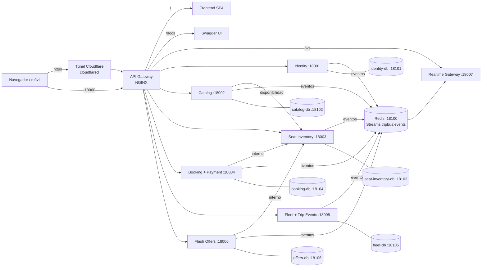

# TripBus · API Gateway y despliegue de la plataforma

Punto de entrada único de TripBus (NGINX): el **frontend** en `/`, el REST (también versionado en `/api/v1`),
el WebSocket `/ws` y la documentación `/docs`. Es además el repositorio de orquestación: desde aquí se levanta la
plataforma completa (7 microservicios + frontend + API Gateway + 6 PostgreSQL + Redis, con copias diarias,
observabilidad y túnel de Cloudflare opcionales) en dos entornos con Docker Compose, y en Kubernetes con
kustomize ([`k8s/`](k8s/README.md)):

| Entorno | Dónde | Rama | Imágenes | Puertos publicados |
|---|---|---|---|---|
| **QA** | tu PC | `develop` | se compilan desde el código de cada repo (frontend incluido) | todos (18000–18007, 18100–18106, 18025 Mailpit, 18030 Grafana, 9090 Prometheus) |
| **PROD** | un servidor | `main` | `ghcr.io/trip-bus/<servicio>:prod` (CI) | solo 18000 (app, REST y WebSocket); público por el túnel de Cloudflare |



## Puertos (convención v3.1)

| Componente | Puerto | PostgreSQL propia (puerto en QA → BD / usuario) |
|---|---|---|
| api-gateway (NGINX) | **18000** | — |
| identity | 18001 | identity-db **18101** → `tripbus_identity` / `identity` |
| catalog-service | 18002 | catalog-db **18102** → `tripbus_catalog` / `catalog` |
| seat-inventory-service | 18003 | seat-inventory-db **18103** → `tripbus_inventory` / `inventory` |
| booking-payment-service | 18004 | booking-db **18104** → `tripbus_booking` / `booking` |
| fleet-trip-events-service | 18005 | fleet-db **18105** → `tripbus_fleet` / `fleet` |
| flash-offers-service (repo `flash-offerts-service`) | 18006 | offers-db **18106** → `tripbus_offers` / `offers` |
| realtime-gateway | 18007 (el cliente entra por 18000 `/ws`) | sin BD (solo Redis) |
| Redis (compartido, con contraseña) | 18100 | — |

Cada servicio tiene **su propia PostgreSQL** (ya no hay una base compartida). Dentro de Docker los
contenedores se hablan por nombre y puerto interno (`http://catalog-service:18002`, `identity-db:5432`).

## Archivos

| Archivo | Para qué |
|---|---|
| `docker-compose.yml` | **Base** común a QA y PROD: BDs, Redis, llaves JWT, 7 servicios, frontend, Swagger UI, gateway, copias diarias (`backups`) y, con el profile `observabilidad`, Prometheus, OpenTelemetry Collector, Tempo, Loki, Promtail y Grafana. Sin puertos. |
| `docker-compose.qa.yml` | Override QA: `build` desde el código (`GIT_COMMIT=qa-local`; con `TAG=qa` usa las imágenes del CI), publica todos los puertos, simulador, usuarios demo, Mailpit (18025), `/docs` encendido, Grafana (18030) y `cloudflared` con el profile `tunel`. |
| `docker-compose.prod.yml` | Override PROD: imágenes de GHCR, `restart: always`, solo 18000 (18007 no se publica), `cloudflared` siempre, **todos los secretos obligatorios** (también las llaves VAPID y la contraseña de Grafana). |
| `docker-compose.observabilidad.yml` | Solo con el profile `observabilidad` (los scripts lo agregan solos): trazas OTLP, logs JSON y el histograma HTTP en los servicios Java. |
| `infra/` | Configuración montada en los contenedores: Prometheus (+ alertas), OpenTelemetry Collector, Tempo, Promtail, Grafana (datasources y tableros) y el script de copias. |
| `.env.qa.example` | Valores locales de QA (versionado). Copia: `.env.qa` (ignorado por git). |
| `.env.prod.example` | Solo marcadores `CAMBIAR_*` (versionado). Copia en el servidor: `.env.prod` (ignorado). |
| `scripts/qa.ps1`, `scripts/qa.sh` | `up` · `down` · `ps` · `logs [servicio]` · `config` del entorno QA. |
| `scripts/prod.ps1`, `scripts/prod.sh` | `pull` · `up` · `down` · `ps` · `logs [servicio]` · `config` del entorno PROD. |
| `scripts/smoke-test.sh` | Prueba de humo extremo a extremo por el gateway (MVP y sprints 2 a 6: REST, `/api/v1`, frontend, `/docs`, encabezados y `/ws`) y la demo del realtime (18007, QA). |
| `scripts/tunnel-url.(sh\|ps1)` | Enlace del túnel rápido de Cloudflare (lo lee de los logs de `cloudflared`). |
| `scripts/backup-now.(sh\|ps1)`, `scripts/restore.(sh\|ps1)` | Copia inmediata de las 6 bases y restauración de una (pide confirmación). |
| `scripts/k8s-apply.sh` | Despliegue en Kubernetes de un overlay (`qa` o `prod`). |
| `tests/load/` | Pruebas de carga con k6: `drop.js` (oferta relámpago) y `ws.js` (WebSocket). |

Los scripts ejecutan por ti, p. ej. en QA:
`docker compose -p tripbus-qa --env-file .env.qa -f docker-compose.yml -f docker-compose.qa.yml up -d --build`.

## Levantar QA en tu PC

Requisitos: Docker Desktop con **≥ 8 GB de RAM** asignados y los 8 repos clonados (en `develop`). Por
defecto se esperan uno al lado del otro:

```
<carpeta>/
  API-gateway/  identity/  catalog-service/  seat-inventory-service/  booking-payment-service/
  fleet-trip-events-service/  flash-offerts-service/  Realtime-Gateway/
```

Si tu estructura es otra, cambia las rutas `*_SRC` de tu `.env.qa` (p. ej. `IDENTITY_SRC=../../IDENTITY`).

```powershell
cd API-gateway
cp .env.qa.example .env.qa
scripts\qa.ps1 up        # la primera vez tarda: compila los 7 servicios (Maven dentro de Docker)
scripts\qa.ps1 ps        # esperar a que todo esté "healthy" (~2-3 min tras compilar)
scripts\qa.ps1 logs catalog-service
scripts\qa.ps1 down      # detiene conservando los datos (volúmenes)
```

Si Windows responde *"la ejecución de scripts está deshabilitada"*, habilítalos una vez para tu usuario
(`Set-ExecutionPolicy -Scope CurrentUser RemoteSigned`) o usa
`powershell -ExecutionPolicy Bypass -File scripts\qa.ps1 up`.
En Linux/macOS es igual con `scripts/qa.sh`. Ojo: no lo corras a la vez que el `docker-compose.yml`
propio de un servicio: comparten puertos (18100, 1810x…) y fallaría con *port is already allocated*.

| URL | Qué es |
|---|---|
| http://localhost:18000 | **La app** (frontend) y el API Gateway (todas las APIs REST, también en `/api/v1/...`) |
| http://localhost:18000/docs | Swagger UI con el API de los 7 servicios (selector arriba a la derecha) |
| ws://localhost:18000/ws | **WebSocket** a través del gateway: la URL que debe usar el frontend (igual que en PROD) |
| http://localhost:18007 | Realtime Gateway directo + **página de demo** (solo QA, para depurar; en PROD no se publica) |
| localhost:18101…18106 / 18100 | PostgreSQL de cada servicio / Redis (para el IDE o DBeaver) |
| http://localhost:18025 | **Mailpit**: bandeja de los correos que envía QA (tiquetes con QR) |
| http://localhost:9090 | Prometheus (con `COMPOSE_PROFILES=observabilidad` en `.env.qa`) |
| http://localhost:18030 | Grafana (con el profile `observabilidad`; usuario `admin`, contraseña `GRAFANA_ADMIN_PASSWORD`) |

Usuarios de demostración en QA (contraseña `DEMO_USERS_PASSWORD`, por defecto `TripBus2026`):
`admin@tripbus.co`, `operador@tripbus.co`, `conductor@tripbus.co`, `pasajero@tripbus.co`.

**Correos en QA**: abre http://localhost:18025 para ver los tiquetes enviados. Booking + Payment
manda el tiquete con el QR a Mailpit (`mailpit:1025`), que lo guarda en memoria sin enviarlo a
Internet; se pierde al recrear el contenedor. En PROD el correo queda apagado hasta poner el SMTP
del proveedor en `MAIL_HOST`, `MAIL_PORT`, `MAIL_USERNAME`, `MAIL_PASSWORD` y `MAIL_FROM` de `.env.prod`.

**Prueba de humo**: `./scripts/smoke-test.sh` (requiere bash, curl y jq; websocat para los pasos de
WebSocket, si no está se omiten con aviso). Sin jq en Windows, córrela en un contenedor dentro de la red de QA:

```bash
docker run --rm --network tripbus-qa_default -v "$PWD/scripts:/s:ro" alpine:3.20 sh -c \
  "apk add -q bash curl jq coreutils websocat && MAILPIT_URL=http://mailpit:8025 bash /s/smoke-test.sh http://api-gateway:18000 http://realtime-gateway:18007"
```

## Profiles del compose

Se encienden con `COMPOSE_PROFILES` en `.env.qa` / `.env.prod` (separados por comas); los scripts `qa.*` y
`prod.*` agregan el override de observabilidad cuando corresponde.

| Profile | Qué levanta | QA | PROD |
|---|---|---|---|
| (ninguno) | 6 BDs, Redis, 7 servicios, frontend, Swagger UI, gateway, Mailpit (QA) y `backups` | siempre | siempre (+ `cloudflared`) |
| `observabilidad` | Prometheus, OpenTelemetry Collector, Tempo, Loki, Promtail y Grafana; trazas y logs JSON en los servicios | Grafana :18030, Prometheus :9090 | sin puertos (túnel SSH al servidor) |
| `tunel` | `cloudflared` con el túnel de Cloudflare | opcional | no hace falta: en PROD siempre está |

`observability` (el nombre anterior) sigue funcionando como sinónimo de `observabilidad`.

## Frontend detrás del gateway (HT-03) y API versionada (HT-07)

- `/` y cualquier ruta que no sea del API → contenedor `frontend` (`ghcr.io/trip-bus/frontend`, NGINX en el
  puerto 80, devuelve `index.html` para las rutas de la SPA). En QA se compila desde `../frontend`
  (`FRONTEND_SRC`); en PROD usa `FRONTEND_TAG` (el CI del frontend publica `main`, `develop`, `latest` y
  `sha-<corto>`; por defecto el mismo `TAG` del resto).
- **`/api/v1/<ruta>` y `/api/<ruta>`** se reescriben a `/<ruta>` (`rewrite ... last`) y pasan por la misma
  autenticación y los mismos límites. Las rutas sin prefijo siguen funcionando (**antiguas**, para el smoke test
  y los clientes actuales); las nuevas integraciones deben usar `/api/v1`.
- El 404 en JSON (`NOT_FOUND`) queda para las rutas desconocidas bajo `/api/`; cualquier otra ruta
  desconocida es de la app (la SPA muestra su propia página de "no encontrado").
- App y API en el mismo origen: el navegador no necesita CORS. `CORS_ALLOWED_ORIGIN` sigue igual para
  desarrollar con Vite (`http://localhost:5173`). El WebSocket sí manda `Origin`: `WS_ALLOWED_ORIGINS` debe
  incluir el origen del gateway (`http://localhost:18000` en QA, el dominio público en PROD).

## Encabezados de seguridad (HT-12)

En todas las respuestas del gateway (los del contenedor del frontend se ocultan para no duplicarlos):

| Encabezado | Valor |
|---|---|
| `Content-Security-Policy` | `default-src 'self'`; scripts solo `'self'`; estilos `'self' 'unsafe-inline'` + Google Fonts; fuentes `'self'` + `fonts.gstatic.com`; `connect-src 'self'` + `ws(s)://` del mismo host; `frame-ancestors 'none'`; `form-action 'self'` (en `/sandbox/` además `FRONTEND_URL`, porque el banco de prueba redirige al frontend) |
| `X-Content-Type-Options` | `nosniff` |
| `Referrer-Policy` | `strict-origin-when-cross-origin` |
| `X-Frame-Options` | `DENY` |
| `Permissions-Policy` | `geolocation=(self)` (el conductor comparte su ubicación) |
| `Strict-Transport-Security` | solo con `HSTS_ENABLED=true` (detrás del túnel con HTTPS): `max-age=31536000; includeSubDomains` |

`'unsafe-inline'` solo en estilos: las librerías de la app (sonner, vaul) y la página de `/sandbox/` insertan CSS
en línea; los scripts nunca.

## Documentación unificada `/docs` (HT-13)

Swagger UI (`swaggerapi/swagger-ui:v5.29.0`) en `/docs/`, con un selector por servicio. Cada spec lo sirve el
gateway en `/docs/specs/<servicio>` (`identity`, `catalog`, `seat-inventory`, `booking`, `fleet`,
`flash-offers`, `realtime`) desde `/v3/api-docs` del servicio, y cada servicio declara
`OPENAPI_SERVER_URL=/api/v1`: "Try it out" pasa por el gateway (para lo que exige token, `/auth/login` y
**Authorize**). QA: encendido. PROD: solo con `DOCS_ENABLED=true` (y los servicios en perfil `prod` también
apagan springdoc, así que los specs responden 404).

## Túnel de Cloudflare (HT-04)

`cloudflared` (`cloudflare/cloudflared:2025.9.1`) publica el gateway sin abrir puertos: en PROD siempre, en QA
con el profile `tunel`.

- **Sin `CLOUDFLARE_TUNNEL_TOKEN`**: túnel rápido a `http://api-gateway:18000` con un enlace
  `https://<aleatorio>.trycloudflare.com` que cambia en cada reinicio. Verlo: `scripts/tunnel-url.sh [qa|prod]`
  (o `scripts\tunnel-url.ps1`). El WebSocket desde ese enlace necesita el patrón `https://*.trycloudflare.com`
  en `WS_ALLOWED_ORIGINS` (ya está en `.env.qa.example`; el Realtime acepta patrones).
- **Con `CLOUDFLARE_TUNNEL_TOKEN`** (Cloudflare Zero Trust → *Networks → Tunnels → Create*, tipo
  *cloudflared*): `cloudflared tunnel run` con el token: enlace fijo en tu dominio (necesita un dominio en
  Cloudflare). En el panel, el *public hostname* apunta a `http://api-gateway:18000`. Pon ese dominio en
  `FRONTEND_URL`, `PUBLIC_API_URL`, `WS_ALLOWED_ORIGINS` y `CORS_ALLOWED_ORIGIN`, y `HSTS_ENABLED=true`.
- El gateway toma la IP real del visitante del header `CF-Connecting-IP` solo si la conexión viene de
  `REAL_IP_FROM` (por defecto `172.16.0.0/12`, las redes de Docker): los límites por IP (rate limit,
  conexiones de `/ws`) cuentan a cada visitante y no a `cloudflared`. El Realtime cuenta sus conexiones por
  IP con `WS_CLIENT_IP_HEADER=X-Forwarded-For` (el gateway pone ahí esa IP).

## Copias de seguridad (HT-05)

El contenedor `backups` (`postgres:16-alpine`, mismo `pg_dump` que las bases) hace una vez al día, a las
`BACKUP_HOUR` (hora de Colombia, 3 por defecto), `pg_dump -Fc` de las 6 bases en
`./backups/AAAA-MM-DD/<servicio>.dump` (`identity`, `catalog`, `seat-inventory`, `booking`, `fleet`,
`offers`) y borra las carpetas con más de `BACKUP_KEEP_DAYS` días (7). `./backups` no se sube a git.

```bash
scripts/backup-now.sh            # copia inmediata (QA; "prod" en el servidor)
scripts/restore.sh catalog backups/2026-11-09/catalog.dump      # pide escribir el servicio para confirmar
# Windows: scripts\backup-now.ps1  ·  scripts\restore.ps1 catalog backups\2026-11-09\catalog.dump
```

`restore` reemplaza la base (`pg_restore --clean --if-exists --no-owner`): detén antes el servicio dueño y
arráncalo después. Las copias quedan en el mismo servidor: cópialas a otro lugar (p. ej. `rclone` a un
almacenamiento externo) si quieres sobrevivir a la pérdida del disco.

## Observabilidad (HT-10)

Con `COMPOSE_PROFILES=observabilidad` (versiones fijas):

| Componente | Imagen | Para qué |
|---|---|---|
| Prometheus | `prom/prometheus:v2.54.1` | Métricas de `/actuator/prometheus` de los 7 servicios (etiqueta `servicio`) y alertas |
| OpenTelemetry Collector | `otel/opentelemetry-collector:0.135.0` | Recibe OTLP de los servicios (`http://otel-collector:4318`) y envía a Tempo |
| Tempo | `grafana/tempo:2.8.2` | Trazas (48 h) |
| Loki + Promtail | `grafana/loki:3.5.5`, `grafana/promtail:3.5.5` | Logs de los contenedores del proyecto (etiquetas `servicio`, `nivel`) |
| Grafana | `grafana/grafana:12.1.1` | Datasources y tableros por código (`infra/grafana`); QA en http://localhost:18030 |

A los servicios Java (`docker-compose.observabilidad.yml`): `OTEL_EXPORTER_OTLP_ENDPOINT=http://otel-collector:4318`
(flash-offers con `/v1/traces`, porque no lo agrega), `LOG_FORMAT=json` (ECS con `traceId`, `spanId` y `requestId`:
desde un log de Loki se abre la traza en Tempo), `TRACING_SAMPLING` (`1.0` en QA, `0.1` por defecto) y el histograma de
`http.server.requests` para el p95.

Tableros (carpeta *TripBus*):

- **Servicios**: arriba/caído, peticiones por segundo, errores 5xx, % de 5xx, p95, memoria, CPU y logs con error.
- **Negocio**: pagos por método y resultado, tiquetes y reembolsos, retenciones, ventas dobles bloqueadas, reservas
  y cupo de las ofertas, ofertas vendidas, pagos aprobados y alertas de operación.
- **Tiempo real**: conexiones (autenticadas o no), suscripciones, mensajes por tipo de tópico, cierres y `resume`.

Alertas (`infra/prometheus/alertas.yml`, visibles en Prometheus `/alerts` y en Grafana → *Alerting*):
**ServicioCaido** (`up == 0` más de 1 min) y **Errores5xxAltos** (más del 5 % de 5xx durante 5 min).

## Pruebas de punta a punta en el pipeline (HT-14)

`.github/workflows/e2e.yml` corre a mano, cada noche (03:00 Colombia) y en los PR hacia `main`: levanta QA con
las imágenes `:qa` de GHCR (frontend `:develop`; el gateway se compila desde el commit), espera los health
checks (`scripts/wait-healthy.sh`), instala jq y websocat y corre `scripts/smoke-test.sh` completo (MVP y
sprints 2 a 6). Si falla, sube los logs de todos los contenedores (artifact `logs-e2e`).

Imágenes privadas: crea los secretos `GHCR_USER` y `GHCR_TOKEN` (PAT con `read:packages`) o da a este repo
acceso de lectura a cada paquete (*Package settings → Manage Actions access*).

Sección de los sprints 5 y 6 (`scripts/smoke-sprint56.sh`): frontend en `/` y fallback de la SPA, `/api/v1`
igual que la ruta vieja, `/docs`, encabezados de seguridad, reconexión con `resume` y límite de conexiones del
WebSocket, compra de un tramo con tipo de pasajero y cupón, comprobante PDF, sala de espera, enlace para
compartir, recorrido y puntualidad, exportar y eliminar mis datos y la auditoría. Lo que aún no está en
`develop` del servicio se omite con un aviso.

En local, igual que el pipeline (con las imágenes del CI en vez de compilar):

```bash
cp .env.qa.example .env.qa
export TAG=qa FRONTEND_TAG=develop
docker compose -p tripbus-qa --env-file .env.qa -f docker-compose.yml -f docker-compose.qa.yml pull
docker compose -p tripbus-qa --env-file .env.qa -f docker-compose.yml -f docker-compose.qa.yml up -d --no-build
scripts/wait-healthy.sh tripbus-qa && MAILPIT_URL=http://localhost:18025 scripts/smoke-test.sh
```

## Prueba de carga (HT-15)

Con k6 (`grafana/k6:1.2.3`), **dentro de la red de Docker de QA** (así el gateway acepta la IP ficticia de cada
usuario virtual en `CF-Connecting-IP` y los límites por IP no frenan a k6 entero):

```bash
# 500 usuarios consultan la vitrina y compiten por una oferta de cupo 50 (los ganadores pagan)
docker run --rm -i --network tripbus-qa_default -v "$PWD/tests/load:/scripts:ro" grafana/k6:1.2.3 \
  run -e API=http://api-gateway:18000 /scripts/drop.js
# 1.000 WebSocket suscritos a ofertas:activas durante 2 min
docker run --rm -i --network tripbus-qa_default -v "$PWD/tests/load:/scripts:ro" grafana/k6:1.2.3 \
  run -e WS=ws://api-gateway:18000/ws /scripts/ws.js
```

| Prueba | Umbrales |
|---|---|
| `drop.js` | cero 5xx (`errores_5xx`, `http_req_failed`), p95 < 800 ms en la competencia (`http_req_duration{fase:drop}`), exactamente 50 reservas (`reservas_ok`) y 50 ventas en `GET /offers/{id}/metrics` (`ventas_oferta`). Los 429 y 409 cuentan como respuesta correcta. |
| `ws.js` | ≥ 99 % de conexiones abiertas y suscritas (snapshot), cero cierres inesperados, handshake p95 < 1 s. |

Variables: `VUS`, `CUPO`, `ORIGEN`/`DESTINO` (drop) y `VUS`, `DURACION_S`, `ORIGIN` (ws). En GitHub:
*Actions → Carga → Run workflow* (`.github/workflows/load.yml`, solo manual), que deja el resumen en la
ejecución y el artifact `carga`.

**Resultados**: pendientes de la primera ejecución del workflow *Carga* contra QA; se anotan aquí
(p95, ventas, 429 y conexiones) cuando corra.

## Preparar PROD en un servidor

Ejemplo: una VM Linux (Azure for Students, 2 vCPU / 8 GB) con el puerto 18000 abierto (REST y
WebSocket `ws(s)://<servidor>:18000/ws`; 18007 ya no se publica).

```bash
# 1. Docker Engine + plugin compose
curl -fsSL https://get.docker.com | sh && sudo usermod -aG docker $USER   # cerrar sesión y volver a entrar

# 2. Este repo (PROD no necesita el código de los servicios: usa las imágenes del CI)
mkdir -p ~/tripbus && cd ~/tripbus
git clone -b main https://github.com/Trip-Bus/API-gateway.git && cd API-gateway

# 3. Secretos: cambiar CADA CAMBIAR_* (openssl rand -base64 32; Redis: openssl rand -hex 32) y el dominio
cp .env.prod.example .env.prod && nano .env.prod && chmod 600 .env.prod

# 4. Login a GHCR: las imágenes son privadas. PAT (classic) con solo el scope read:packages.
echo "<PAT>" | docker login ghcr.io -u <usuario-github> --password-stdin

# 5. Descargar y levantar
scripts/prod.sh pull
scripts/prod.sh up
scripts/prod.sh ps
```

`scripts/prod.sh` se niega a arrancar si `.env.prod` no existe o aún tiene valores `CAMBIAR_*`, y el
compose de PROD se niega si falta cualquier secreto (`${VAR:?Falta VAR en .env.prod}`). En PROD el
perfil Spring es `prod`: sin usuarios de demostración, sin Swagger y el simulador GPS apagado.
Para fijar una versión concreta usa `TAG=sha-<corto>` en `.env.prod`.

## Flujo de ramas

```
rama de trabajo --PR--> develop (QA) --PR de release--> main (PROD)
```

- Los PR **siempre** van a `develop`. `main` solo recibe el PR de release desde `develop`.
- Push a `develop` → el CI de cada repo publica `:qa`, `:develop`, `:sha-<corto>`.
- Push a `main` → publica `:prod`, `:latest`, `:sha-<corto>` y (si está activado) despliega PROD.

## CI/CD de este repo (`.github/workflows/ci-cd.yml`)

| Job | Qué hace |
|---|---|
| `secretos` | Gitleaks (`ghcr.io/gitleaks/gitleaks:v8.30.1`) sobre todo el historial. |
| `validar` | Renderiza la plantilla de NGINX y corre `nginx -t`; `docker compose config -q` de QA y de PROD con los `.example` (también con observabilidad y túnel); `kustomize build` de `k8s/overlays/{qa,prod}` + **kubeconform**; `actionlint`. |
| `docker` | Construye la imagen, Trivy (CRITICAL/HIGH, `ignore-unfixed`) y, solo en push, la publica en GHCR. |
| `deploy` | PROD por SSH. Solo en push a `main` y con `DEPLOY_ENABLED=true`. **Apagado** hasta tener servidor. |

Además: `.github/workflows/e2e.yml` (pruebas de punta a punta, ver HT-14) y `.github/workflows/load.yml`
(prueba de carga, manual).

**Sin SonarQube ni JaCoCo**: este repo no tiene código Java (solo configuración de NGINX, compose y
scripts), así que no hay pruebas unitarias ni cobertura que medir. Su "calidad" es que la
configuración sea válida (`nginx -t`, `compose config`, `actionlint`), que no haya secretos (Gitleaks)
y que la imagen no tenga vulnerabilidades corregibles (Trivy).

### Secretos y variables del repo

| Nombre | Tipo | Para qué |
|---|---|---|
| `DOCKERHUB_USERNAME`, `DOCKERHUB_TOKEN` | secret (opcional) | Login a Docker Hub (token de solo lectura) para no chocar con el límite de descargas. |
| `DEPLOY_ENABLED` | variable | `true` activa el job `deploy`. |
| `DEPLOY_PATH` | variable (opcional) | Ruta del clon en el servidor (por defecto `~/tripbus/API-gateway`). |
| `DEPLOY_HOST`, `DEPLOY_USER`, `DEPLOY_SSH_KEY` | secret | IP/dominio, usuario y llave **privada** SSH del servidor. |
| `GHCR_USER`, `GHCR_TOKEN` | secret | Usuario de GitHub y PAT con `read:packages`: `docker login ghcr.io` del servidor y de los workflows E2E y Carga. |

### Variables de entorno nuevas

| Variable | Servicios | QA | PROD |
|---|---|---|---|
| `FRONTEND_URL` | Identity, Booking | `http://localhost:5173` | Obligatoria: URL pública del frontend (configúrala en `.env.prod`; Compose falla si falta). |
| `MAIL_HOST`, `MAIL_PORT`, `MAIL_USERNAME`, `MAIL_PASSWORD`, `MAIL_FROM` | Identity y Booking | Identity/Booking usan Mailpit (`mailpit:1025`); credenciales vacías | SMTP opcional; valores vacíos desactivan el envío de correo. |
| `MFA_ENCRYPTION_KEY` | Identity | valor de `.env.qa.example` | **Obligatoria** (compose falla si falta). |
| `VAPID_PUBLIC_KEY`, `VAPID_PRIVATE_KEY`, `VAPID_SUBJECT` | Realtime (push, US-185) | vacías = push apagado (503 `PUSH_DISABLED`) | **Obligatorias**: `docker run --rm node:22-alpine npx -y web-push generate-vapid-keys` |
| `WS_CLIENT_IP_HEADER` | Realtime | `X-Forwarded-For` (fijo en el compose) | igual |
| `OPENAPI_SERVER_URL` | los 7 servicios | `/api/v1` (fijo en el compose) | igual |
| `OTEL_EXPORTER_OTLP_ENDPOINT`, `LOG_FORMAT`, `TRACING_SAMPLING` | los 7 servicios | con el profile `observabilidad`; muestreo `1.0` | con el profile; muestreo `0.1` |
| `FRONTEND_SRC` / `FRONTEND_TAG` | frontend | `../frontend` (compila) | `main` (tag del CI del frontend) |
| `DOCS_ENABLED`, `HSTS_ENABLED` | api-gateway | `/docs` encendido, sin HSTS | `false` / `false` (HSTS `true` detrás de HTTPS) |
| `CLOUDFLARE_TUNNEL_TOKEN` | cloudflared | vacía = túnel rápido | vacía = túnel rápido; con token = túnel con nombre |
| `BACKUP_HOUR`, `BACKUP_KEEP_DAYS` | backups | 3 y 7 | 3 y 7 |
| `GRAFANA_ADMIN_PASSWORD` | grafana | `admin` | **Obligatoria** |

### Activar el deploy

1. Prepara el servidor (sección anterior) y verifica que `scripts/prod.sh up` funcione a mano.
2. En el servidor crea una llave solo para el CI: `ssh-keygen -t ed25519 -f ~/.ssh/tripbus_ci -N ""` y
   `cat ~/.ssh/tripbus_ci.pub >> ~/.ssh/authorized_keys`.
3. En GitHub → *Settings → Secrets and variables → Actions*: secretos `DEPLOY_HOST`, `DEPLOY_USER`,
   `DEPLOY_SSH_KEY` (contenido de `~/.ssh/tripbus_ci`), `GHCR_USER`, `GHCR_TOKEN`; variable `DEPLOY_ENABLED=true`.
4. El job usa el environment `produccion` (se crea solo); puedes exigir aprobación manual en
   *Settings → Environments → produccion → Required reviewers*.
5. Cada push a `main` hará en el servidor: `git pull`, `docker login ghcr.io`, `scripts/prod.sh pull`, `scripts/prod.sh up`.

## Rutas del API Gateway

Todas las rutas también responden bajo **`/api/v1`** (y `/api`), con la misma autenticación y los mismos
límites (HT-07); las de la tabla, sin prefijo, son las **antiguas** y siguen funcionando. `/` y las demás rutas
son del frontend.

| Prefijo | Servicio | Autenticación en el borde |
|---|---|---|
| `/` (cualquier ruta que no sea del API) | Frontend | pública (la app) |
| `/api/v1/*`, `/api/*` | el de la ruta sin prefijo | la de la ruta sin prefijo; desconocida → 404 JSON |
| `/docs/`, `/docs/specs/<servicio>` | Swagger UI / `/v3/api-docs` de cada servicio | pública (solo con `DOCS_ENABLED=true`) |
| `/auth/login`, `/auth/register`, `/auth/password-reset/*`, `/auth/refresh`, `/auth/verify-email`, `/auth/2fa`, `/auth/google` | Identity | públicas (rate limit estricto) |
| `/auth/providers` | Identity | pública (proveedores de login activos, p. ej. Google) |
| `/auth/verify-email/resend` | Identity | JWT |
| `/users`, `/users/*` (incluye `/users/me`, `/users/me/password`, `/users/me/data`, `/users/me/delete`, `/users/{id}/lock`) | Identity | JWT |
| `/auth/logout`, `/users/me/2fa/*` | Identity | JWT validado por identity (sin `auth_request`): con `MFA_REQUIRED_ROLES`, quien aún no activa la 2FA solo puede activarla o cerrar sesión |
| `/admin/audit*` | Identity | JWT (ADMIN; regex, gana a `/admin/` de Catalog) |
| `/.well-known/jwks.json` | Identity | pública |
| `/trips/search`, `/trips/search/companies`, `/trips/cities`, `/trips/calendar`, `/trips/round-trip` | Catalog | públicas |
| `/terminals`, `/terminals/*` | Catalog | GET público; POST/PUT/DELETE JWT (ADMIN) |
| `/places` | Catalog | pública (autocompletado de ciudades y terminales) |
| `/fares/*` (`seasons`, `passenger-types`, `seat-surcharges`) | Catalog | JWT (OPERADOR/ADMIN) |
| `/companies`, `/companies/*`, `/buses`, `/buses/*` | Catalog | JWT |
| `/routes`, `/routes/*` | Catalog | GET público (p. ej. `/routes/{id}/stops`, `/routes/{id}/segment-prices`), POST/PUT/PATCH JWT |
| `/itineraries` | Catalog | JWT (listado del operador) |
| `/itineraries/*` | Catalog | GET público (detalle, seatmap, precio, `/{id}/changes`), POST/PATCH JWT (`/itineraries/schedule`, `/{id}/departure`, `/{id}/bus`) |
| `/itineraries/{id}/manifest` | Booking + Payment | JWT (manifiesto de pasajeros, JSON o `?format=csv`) |
| `/admin/*` | Catalog | JWT |
| `/operator/` | Catalog | JWT (incluye panel `/operator/trips`) |
| `/seats/*` | Seat Inventory | GET público salvo ocupación y lista de espera; el resto JWT |
| `/seats/itineraries/{id}/occupancy`, `/seats/itineraries/{id}/waitlist`, `/seats/waitlist/*` | Seat Inventory | JWT en todos los métodos |
| `/bookings*`, `/tickets/*` | Booking + Payment | JWT (incluye `/bookings/affected`, `/bookings/{id}/reschedule`, `/bookings/{id}/affected/*`) |
| `/box-office/*`, `/reports/*` | Booking + Payment | JWT |
| `/payments/*` | Booking + Payment | GET público (bancos PSE); otros métodos JWT |
| `/payments/{id}/receipt.pdf`, `/refunds/*` | Booking + Payment | JWT (comprobantes en PDF) |
| `/coupons`, `/coupons/*` | Booking + Payment | JWT (ADMIN/OPERADOR) |
| `/sandbox/*` | Booking + Payment | público (página/formulario de banco de prueba) |
| `/webhooks/payment` | Booking + Payment | firma HMAC (no JWT) |
| `/telemetry/*` (temporal, se retira en el Sprint 5), `/trips/{id}/events` | Fleet + Trip Events | JWT |
| `/trips/{id}/driver`, `/trips/{id}/driver/*` | Fleet + Trip Events | JWT (asignar conductores: OPERADOR/ADMIN) |
| `/trips/{id}/finish`, `/trips/{id}/alerts*`, `/alerts`, `/alerts/*` | Fleet + Trip Events | JWT (OPERADOR/ADMIN) |
| `/driver/*` (`/driver/trips`, `/driver/trips/{id}/start`, `/driver/trips/{id}/finish`, `/driver/tracking/*`) | Fleet + Trip Events | JWT (CONDUCTOR) |
| `/driver/location`, `/driver/location/batch` | Fleet + Trip Events | JWT, rate limit por usuario (como `/telemetry/`) |
| `/driver/sos` | Fleet + Trip Events | JWT, solo el límite general (un SOS nunca recibe 429 por el límite de `/driver/location`) |
| `/trips/{id}/timeline`, `/itineraries/{id}/bus-position`, `/itineraries/{id}/eta`, `/itineraries/{id}/track`, `/buses/{id}/position` (temporal) | Fleet + Trip Events | públicas |
| `/share-links` | Fleet + Trip Events | JWT (crear el enlace para compartir el viaje) |
| `/share/{codigo}` | Fleet + Trip Events | pública (el familiar abre el enlace) |
| `/reports/punctuality` | Fleet + Trip Events | JWT (regex, gana a `/reports/` de Booking) |
| `/operator/offers*`, `/operator/auto-offer-rules*`, `/operator/offer-templates*` | Flash Offers | JWT (prefijos más específicos que `/operator/` de Catalog) |
| `/offers/{id}/queue`, `/offers/{id}/queue/*` | Flash Offers | JWT en todos los métodos (sala de espera) |
| `/offers/showcase` | Flash Offers | público |
| `/offers/follows`, `/offers/{id}/metrics`, resto de `/offers*` | Flash Offers | JWT; GET de ofertas públicas solo en el resto de `/offers*` |
| `/fleet/*` | Fleet + Trip Events | JWT |
| `/ws` (WebSocket) | Realtime Gateway | JWT validado por el Realtime en el handshake; 20 conexiones abiertas por IP |
| `/push/public-key` | Realtime Gateway | pública (llave VAPID) |
| `/push/*` (`/push/subscriptions`) | Realtime Gateway | JWT |
| `/auth/validate`, `/internal/*`, `/actuator/*` | — | **nunca** expuestas (404 JSON) |
| `/health` | gateway | salud del propio NGINX |

- **Validación de JWT en el borde**: `auth_request` → subpetición interna a `identity /auth/validate`
  (también rechaza tokens revocados por logout). Desde fuera `/auth/validate` responde 404.
  Si el rol exige la verificación en dos pasos y aún no está activa (`MFA_REQUIRED_ROLES` de identity),
  `/auth/validate` responde 403 y el gateway devuelve `403 MFA_SETUP_REQUIRED` en JSON.
- **Resolución DNS dinámica**: cada upstream usa `zone` + `server <host>:<puerto> resolve` (NGINX
  open source ≥ 1.27.3; la imagen está fijada a `nginx:1.29.8-alpine`) con `resolver ${RESOLVER}`
  (por defecto `127.0.0.11 valid=10s ipv6=off`, el DNS de Docker). Si un servicio se reinicia con
  otra IP o se escala (`--scale`), el gateway lo sigue sin reiniciarse.
- **Rate limiting**: por IP (30 r/s), por usuario/token (10 r/s) y login/registro (5 r/s) → `429` JSON.
- **CORS**: `CORS_ALLOWED_ORIGIN` es una lista separada por comas; solo esos orígenes reciben
  `Access-Control-Allow-Origin` (sin `*` por defecto). QA: `http://localhost:5173,http://localhost:18007`.
- **Logs** de acceso en JSON con `request_id`. Si el cliente manda `X-Request-Id` (≤ 64 caracteres
  `[A-Za-z0-9._-]`) se respeta y se propaga a los servicios; si no, NGINX genera uno.
- **WebSocket** (`ws(s)://<gateway>:18000/ws`, upstream `REALTIME_UPSTREAM`, por defecto
  `realtime-gateway:18007`): upgrade HTTP/1.1, timeouts de 75 s (el servidor envía ping cada 20 s),
  sin buffering. El access log de `/ws` usa `$uri` (sin `?token=JWT`) y su error log solo registra
  `crit`, porque NGINX copia la petición completa en los mensajes de error.

## Kubernetes (HT-06)

`k8s/` es una base de **kustomize** con overlays `qa` y `prod` para los 7 servicios, el gateway, el frontend,
Redis y las 6 PostgreSQL (StatefulSet): ConfigMaps, plantillas de Secret sin valores reales, probes de
`/actuator/health`, recursos y el Service de cada uno. El CI la valida con kubeconform (sin clúster).
PROD sigue en Docker Compose. Detalle, secretos y despliegue: [`k8s/README.md`](k8s/README.md).

## Más

- Contratos, eventos y decisiones: [`docs/arquitectura.md`](docs/arquitectura.md).
- Despliegue en 2 máquinas por Tailscale con Catalog y Seat Inventory replicados (escenario 1.1):
  [`docs/despliegue-distribuido.md`](docs/despliegue-distribuido.md).
- `tools/prefetch-deps` — descarga a `~/.m2` todas las dependencias Maven de los servicios (trabajo sin conexión).
