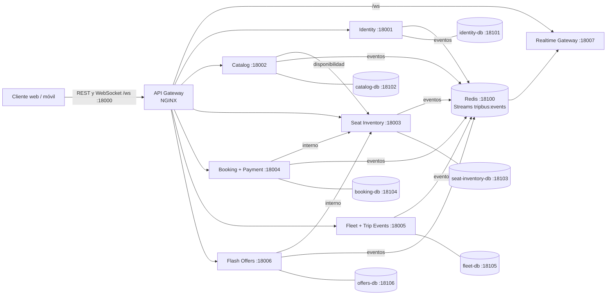

# TripBus · API Gateway y despliegue de la plataforma

Punto de entrada único de TripBus, REST y WebSocket (NGINX) **y** repositorio de orquestación: desde aquí se
levanta la plataforma completa (7 microservicios + API Gateway + 6 PostgreSQL + Redis) en dos entornos,
ambos con Docker Compose:

| Entorno | Dónde | Rama | Imágenes | Puertos publicados |
|---|---|---|---|---|
| **QA** | tu PC | `develop` | se compilan desde el código de cada repo | todos (18000–18007, 18100–18106, 18025 Mailpit) |
| **PROD** | un servidor | `main` | `ghcr.io/trip-bus/<servicio>:prod` (CI) | solo 18000 (REST y WebSocket `/ws`) |



## Puertos (convención v3.1)

| Componente | Puerto | PostgreSQL propia (puerto en QA → BD / usuario) |
|---|---|---|
| api-gateway (NGINX) | **18000** | — |
| identity | 18001 | identity-db **18101** → `tripbus_identity` / `identity` |
| catalog-service | 18002 | catalog-db **18102** → `tripbus_catalog` / `catalog` |
| seat-inventory-service | 18003 | seat-inventory-db **18103** → `tripbus_inventory` / `inventory` |
| booking-payment-service | 18004 | booking-db **18104** → `tripbus_booking` / `booking` |
| fleet-trip-events-service | 18005 | fleet-db **18105** → `tripbus_fleet` / `fleet` |
| flash-offers-service (repo `flash-offerts-service`) | 18006 | offers-db **18106** → `tripbus_offers` / `offers` |
| realtime-gateway | 18007 (el cliente entra por 18000 `/ws`) | sin BD (solo Redis) |
| Redis (compartido, con contraseña) | 18100 | — |

Cada servicio tiene **su propia PostgreSQL** (ya no hay una base compartida). Dentro de Docker los
contenedores se hablan por nombre y puerto interno (`http://catalog-service:18002`, `identity-db:5432`).

## Archivos

| Archivo | Para qué |
|---|---|
| `docker-compose.yml` | **Base** común a QA y PROD: BDs, Redis, llaves JWT, 7 servicios, gateway, Prometheus (profile `observability`). Sin puertos. |
| `docker-compose.qa.yml` | Override QA: `build` desde el código (`GIT_COMMIT=qa-local`), publica todos los puertos, simulador, usuarios demo y Mailpit (correos, 18025). |
| `docker-compose.prod.yml` | Override PROD: imágenes de GHCR, `restart: always`, solo 18000 (18007 no se publica), **todos los secretos obligatorios**. |
| `.env.qa.example` | Valores locales de QA (versionado). Copia: `.env.qa` (ignorado por git). |
| `.env.prod.example` | Solo marcadores `CAMBIAR_*` (versionado). Copia en el servidor: `.env.prod` (ignorado). |
| `scripts/qa.ps1`, `scripts/qa.sh` | `up` · `down` · `ps` · `logs [servicio]` · `config` del entorno QA. |
| `scripts/prod.ps1`, `scripts/prod.sh` | `pull` · `up` · `down` · `ps` · `logs [servicio]` · `config` del entorno PROD. |
| `scripts/smoke-test.sh` | Prueba de humo extremo a extremo por el gateway (18000, REST y handshake `/ws`) y la demo del realtime (18007, QA). |

Los scripts ejecutan por ti, p. ej. en QA:
`docker compose -p tripbus-qa --env-file .env.qa -f docker-compose.yml -f docker-compose.qa.yml up -d --build`.

## Levantar QA en tu PC

Requisitos: Docker Desktop con **≥ 8 GB de RAM** asignados y los 8 repos clonados (en `develop`). Por
defecto se esperan uno al lado del otro:

```
<carpeta>/
  API-gateway/  identity/  catalog-service/  seat-inventory-service/  booking-payment-service/
  fleet-trip-events-service/  flash-offerts-service/  Realtime-Gateway/
```

Si tu estructura es otra, cambia las rutas `*_SRC` de tu `.env.qa` (p. ej. `IDENTITY_SRC=../../IDENTITY`).

```powershell
cd API-gateway
cp .env.qa.example .env.qa
scripts\qa.ps1 up        # la primera vez tarda: compila los 7 servicios (Maven dentro de Docker)
scripts\qa.ps1 ps        # esperar a que todo esté "healthy" (~2-3 min tras compilar)
scripts\qa.ps1 logs catalog-service
scripts\qa.ps1 down      # detiene conservando los datos (volúmenes)
```

Si Windows responde *"la ejecución de scripts está deshabilitada"*, habilítalos una vez para tu usuario
(`Set-ExecutionPolicy -Scope CurrentUser RemoteSigned`) o usa
`powershell -ExecutionPolicy Bypass -File scripts\qa.ps1 up`.
En Linux/macOS es igual con `scripts/qa.sh`. Ojo: no lo corras a la vez que el `docker-compose.yml`
propio de un servicio: comparten puertos (18100, 1810x…) y fallaría con *port is already allocated*.

| URL | Qué es |
|---|---|
| http://localhost:18000 | API Gateway (todas las APIs REST) |
| ws://localhost:18000/ws | **WebSocket** a través del gateway: la URL que debe usar el frontend (igual que en PROD) |
| http://localhost:18007 | Realtime Gateway directo + **página de demo** (solo QA, para depurar; en PROD no se publica) |
| localhost:18101…18106 / 18100 | PostgreSQL de cada servicio / Redis (para el IDE o DBeaver) |
| http://localhost:18025 | **Mailpit**: bandeja de los correos que envía QA (tiquetes con QR) |
| http://localhost:9090 | Prometheus (con `COMPOSE_PROFILES=observability` en `.env.qa`) |

Usuarios de demostración en QA (contraseña `DEMO_USERS_PASSWORD`, por defecto `TripBus2026`):
`admin@tripbus.co`, `operador@tripbus.co`, `conductor@tripbus.co`, `pasajero@tripbus.co`.

**Correos en QA**: abre http://localhost:18025 para ver los tiquetes enviados. Booking + Payment
manda el tiquete con el QR a Mailpit (`mailpit:1025`), que lo guarda en memoria sin enviarlo a
Internet; se pierde al recrear el contenedor. En PROD el correo queda apagado hasta poner el SMTP
del proveedor en `MAIL_HOST`, `MAIL_PORT`, `MAIL_USERNAME`, `MAIL_PASSWORD` y `MAIL_FROM` de `.env.prod`.

**Prueba de humo**: `./scripts/smoke-test.sh` (requiere bash, curl y jq). Sin jq en Windows, córrela
en un contenedor dentro de la red de QA:

```bash
docker run --rm --network tripbus-qa_default -v "$PWD/scripts:/s:ro" alpine:3.20 sh -c \
  "apk add -q bash curl jq coreutils && bash /s/smoke-test.sh http://api-gateway:18000 http://realtime-gateway:18007"
```

## Preparar PROD en un servidor

Ejemplo: una VM Linux (Azure for Students, 2 vCPU / 8 GB) con el puerto 18000 abierto (REST y
WebSocket `ws(s)://<servidor>:18000/ws`; 18007 ya no se publica).

```bash
# 1. Docker Engine + plugin compose
curl -fsSL https://get.docker.com | sh && sudo usermod -aG docker $USER   # cerrar sesión y volver a entrar

# 2. Este repo (PROD no necesita el código de los servicios: usa las imágenes del CI)
mkdir -p ~/tripbus && cd ~/tripbus
git clone -b main https://github.com/Trip-Bus/API-gateway.git && cd API-gateway

# 3. Secretos: cambiar CADA CAMBIAR_* (openssl rand -base64 32; Redis: openssl rand -hex 32) y el dominio
cp .env.prod.example .env.prod && nano .env.prod && chmod 600 .env.prod

# 4. Login a GHCR: las imágenes son privadas. PAT (classic) con solo el scope read:packages.
echo "<PAT>" | docker login ghcr.io -u <usuario-github> --password-stdin

# 5. Descargar y levantar
scripts/prod.sh pull
scripts/prod.sh up
scripts/prod.sh ps
```

`scripts/prod.sh` se niega a arrancar si `.env.prod` no existe o aún tiene valores `CAMBIAR_*`, y el
compose de PROD se niega si falta cualquier secreto (`${VAR:?Falta VAR en .env.prod}`). En PROD el
perfil Spring es `prod`: sin usuarios de demostración, sin Swagger y el simulador GPS apagado.
Para fijar una versión concreta usa `TAG=sha-<corto>` en `.env.prod`.

## Flujo de ramas

```
rama de trabajo --PR--> develop (QA) --PR de release--> main (PROD)
```

- Los PR **siempre** van a `develop`. `main` solo recibe el PR de release desde `develop`.
- Push a `develop` → el CI de cada repo publica `:qa`, `:develop`, `:sha-<corto>`.
- Push a `main` → publica `:prod`, `:latest`, `:sha-<corto>` y (si está activado) despliega PROD.

## CI/CD de este repo (`.github/workflows/ci-cd.yml`)

| Job | Qué hace |
|---|---|
| `secretos` | Gitleaks (`ghcr.io/gitleaks/gitleaks:v8.30.1`) sobre todo el historial. |
| `validar` | Renderiza la plantilla de NGINX y corre `nginx -t`; `docker compose config -q` de QA y de PROD con los `.example`; `actionlint`. |
| `docker` | Construye la imagen, Trivy (CRITICAL/HIGH, `ignore-unfixed`) y, solo en push, la publica en GHCR. |
| `deploy` | PROD por SSH. Solo en push a `main` y con `DEPLOY_ENABLED=true`. **Apagado** hasta tener servidor. |

**Sin SonarQube ni JaCoCo**: este repo no tiene código Java (solo configuración de NGINX, compose y
scripts), así que no hay pruebas unitarias ni cobertura que medir. Su "calidad" es que la
configuración sea válida (`nginx -t`, `compose config`, `actionlint`), que no haya secretos (Gitleaks)
y que la imagen no tenga vulnerabilidades corregibles (Trivy).

### Secretos y variables del repo

| Nombre | Tipo | Para qué |
|---|---|---|
| `DOCKERHUB_USERNAME`, `DOCKERHUB_TOKEN` | secret (opcional) | Login a Docker Hub (token de solo lectura) para no chocar con el límite de descargas. |
| `DEPLOY_ENABLED` | variable | `true` activa el job `deploy`. |
| `DEPLOY_PATH` | variable (opcional) | Ruta del clon en el servidor (por defecto `~/tripbus/API-gateway`). |
| `DEPLOY_HOST`, `DEPLOY_USER`, `DEPLOY_SSH_KEY` | secret | IP/dominio, usuario y llave **privada** SSH del servidor. |
| `GHCR_USER`, `GHCR_TOKEN` | secret | Usuario de GitHub y PAT con `read:packages` para el `docker login ghcr.io` del servidor. |

### Activar el deploy

1. Prepara el servidor (sección anterior) y verifica que `scripts/prod.sh up` funcione a mano.
2. En el servidor crea una llave solo para el CI: `ssh-keygen -t ed25519 -f ~/.ssh/tripbus_ci -N ""` y
   `cat ~/.ssh/tripbus_ci.pub >> ~/.ssh/authorized_keys`.
3. En GitHub → *Settings → Secrets and variables → Actions*: secretos `DEPLOY_HOST`, `DEPLOY_USER`,
   `DEPLOY_SSH_KEY` (contenido de `~/.ssh/tripbus_ci`), `GHCR_USER`, `GHCR_TOKEN`; variable `DEPLOY_ENABLED=true`.
4. El job usa el environment `produccion` (se crea solo); puedes exigir aprobación manual en
   *Settings → Environments → produccion → Required reviewers*.
5. Cada push a `main` hará en el servidor: `git pull`, `docker login ghcr.io`, `scripts/prod.sh pull`, `scripts/prod.sh up`.

## Rutas del API Gateway

| Prefijo | Servicio | Autenticación en el borde |
|---|---|---|
| `/auth/login`, `/auth/register`, `/auth/password-reset/*` | Identity | públicas (rate limit estricto) |
| `/auth/logout`, `/users/*` | Identity | JWT |
| `/.well-known/jwks.json` | Identity | pública |
| `/trips/search`, `/trips/cities`, `/itineraries/*`, `/routes/*` | Catalog | públicas |
| `/admin/*` | Catalog | JWT |
| `/seats/*` | Seat Inventory | GET público, el resto JWT |
| `/bookings*`, `/tickets/*` | Booking + Payment | JWT |
| `/webhooks/payment` | Booking + Payment | firma HMAC (no JWT) |
| `/telemetry/*`, `/trips/{id}/events` | Fleet + Trip Events | JWT |
| `/trips/{id}/timeline`, `/itineraries/{id}/bus-position`, `/buses/*` | Fleet + Trip Events | públicas |
| `/offers*` | Flash Offers | GET público, el resto JWT |
| `/ws` (WebSocket) | Realtime Gateway | JWT validado por el Realtime en el handshake; 20 conexiones abiertas por IP |
| `/auth/validate`, `/internal/*`, `/actuator/*` | — | **nunca** expuestas (404 JSON) |
| `/health` | gateway | salud del propio NGINX |

- **Validación de JWT en el borde**: `auth_request` → subpetición interna a `identity /auth/validate`
  (también rechaza tokens revocados por logout). Desde fuera `/auth/validate` responde 404.
- **Resolución DNS dinámica**: cada upstream usa `zone` + `server <host>:<puerto> resolve` (NGINX
  open source ≥ 1.27.3; la imagen está fijada a `nginx:1.29.8-alpine`) con `resolver ${RESOLVER}`
  (por defecto `127.0.0.11 valid=10s ipv6=off`, el DNS de Docker). Si un servicio se reinicia con
  otra IP o se escala (`--scale`), el gateway lo sigue sin reiniciarse.
- **Rate limiting**: por IP (30 r/s), por usuario/token (10 r/s) y login/registro (5 r/s) → `429` JSON.
- **CORS**: `CORS_ALLOWED_ORIGIN` es una lista separada por comas; solo esos orígenes reciben
  `Access-Control-Allow-Origin` (sin `*` por defecto). QA: `http://localhost:5173,http://localhost:18007`.
- **Logs** de acceso en JSON con `request_id`. Si el cliente manda `X-Request-Id` (≤ 64 caracteres
  `[A-Za-z0-9._-]`) se respeta y se propaga a los servicios; si no, NGINX genera uno.
- **WebSocket** (`ws(s)://<gateway>:18000/ws`, upstream `REALTIME_UPSTREAM`, por defecto
  `realtime-gateway:18007`): upgrade HTTP/1.1, timeouts de 75 s (el servidor envía ping cada 20 s),
  sin buffering. El access log de `/ws` usa `$uri` (sin `?token=JWT`) y su error log solo registra
  `crit`, porque NGINX copia la petición completa en los mensajes de error.

## Kubernetes (desactualizado)

`k8s/` y `scripts/k8s-apply.sh` **no se usan**: siguen con los puertos 1600x y una PostgreSQL
compartida. PROD usa Docker Compose. Ver [`k8s/README.md`](k8s/README.md).

## Más

- Contratos, eventos y decisiones: [`docs/arquitectura.md`](docs/arquitectura.md).
- `tools/prefetch-deps` — descarga a `~/.m2` todas las dependencias Maven de los servicios (trabajo sin conexión).
